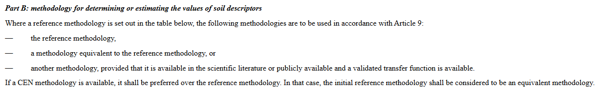
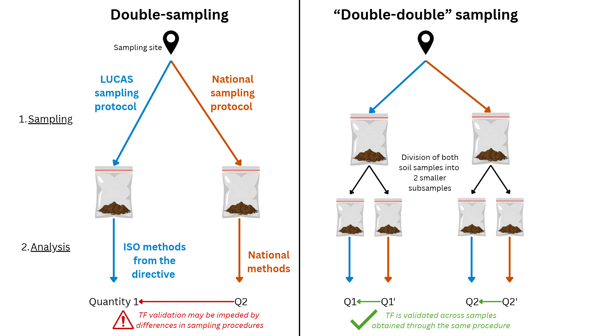

# Definitions {.unnumbered}

In this chapter, we will translate SML terminology and requirements in clear statistical notation and definitions.
@fig-SML is an extract from the SML (annex II, part B) and will be used as starting point:

:::{#fig-SML}

Extract from the Soil Monitoring Law, Annex II, part B

:::

Several elements from this SML-extract are detailed below.

**Soil descriptor**

A soil descriptor is a physical or chemical characteristic of a soil that can be measured based on a soil sample.
The SML contains a list of soil descriptors that should be reported by member states.
The same soil descriptor can be measured with multiple measurement methods.
Per soil descriptor, one measurement method is labelled as the reference method and all others as non-reference method.

**Reference method**

Reference methods are standardized protocols made by an international standards office (ISO, CEN, ...).
Reference methods are listed per soil descriptor in the SML.
For statistical notation, we denote the random variable that represents the soil descriptor as measured with the reference method as $Y$.

<!--
Quid variation within the reference method? How do we deal with that? Eg. the SML specifies for pH an ISO norm, but leaves it open which extractant to use and at which soil:solution ratio. Are all variants within the ISO then a reference method and we don't need to translate them to a common standard?
-->

**Non-reference method**

All competing methods to measure the same physical or chemical property as the reference method is a non-reference method (eg. national or regional standards).
For statistical notation, we denote the random variable that represents the soil descriptor as measured with the non-reference method as $X$.

**Double sampling and double-double sampling**

In order to develop and validate transfer functions (see infra), we need to have a dataset with observations of the soil descriptor measured in the same location with both methods.
Such a dataset of paired observations comes from a double sampling study and preferably from a double-double sampling study.

*Double sampling (DS)*: In a DS-study, two compound soil samples are collected on several locations by two field sampling protocols, for example (1) LUCAS field sampling protocol and (2) national field sampling protocol.
A compound soil sample is a mixture of a fixed number of soil sub-samples collected in a fixed area around the point location.
The area (synonym: support), number of sub-samples and depth of the sampling are the parameters of the field sampling protocol.
The two compound samples are then analysed with two lab measurement methods ($Y$ and $X$), giving a dataset of paired observations: $Y_i^{(1)}, X_i^{(2)}$.

*Double-double sampling (DDS)*: In a DDS-study, the two compound samples from the two field sampling protocols are each separated in half (split-samples) and each split-sample is analysed with both lab measurement methods. This gives a dataset of paired observations: $Y_i^{(1)}, Y_i^{(2)}, X_i^{(1)}, X_i^{(2)}$.

:::{#fig-DS-DDS} 

Difference between double-sampling and double-double-sampling. Figure made by Lea Courteille (INRAE).

:::

**Measurement error** 

A set of realizations of these random variables on $n$ locations are denoted by $\mathbf{y} = (y_1, \dots, y_n)$, $\mathbf{x} = (x_1, \dots, x_n)$.
However, due to measurement error we do not observe these latent properties of the soil descriptor at a particular location.
Measurement error is an umbrella term for all sorts of influences that result in a difference between the latent and observed values.
Two major components of the measurement error are the field sampling protocol and the lab measurement protocol.
Elements from the field protocol that affect measurement error are the sample support (area of the location, number of pooled sub-samples), the sample depth and sample method (auger vs. spade).
Measurement error from deviations from the lab protocols contribute to additional uncertainty.
Instead of the latent values, we have observed values $\mathbf{y}_{\text{obs}}$, $\mathbf{x}_{\text{obs}}$ at our disposal to develop transfer and pedotransfer functions.

**Equivalent methods**

The SML mentions that the currently listed reference methods - which are all ISO-standards - will be considered equivalent to CEN methods which will then play the role of reference methods.
This is method equivalence by law.
Other methods can also be considered to be equivalent to the reference method if certain statistical requirements are met.
The statistical procedure to define equivalent methods will be detailed in a next chapter.

**Transfer function**

A transfer function (TF) is a statistical model ($f$) that allows prediction of the soil descriptor values as if it would have been obtained with the reference method when a non-reference method was used.
The observed non-reference method is the primary predictor variable, but auxiliary predictors $\mathbf{Z} = (Z_1, \dots, Z_p)$ can be included as well to allow for more accurate predictions.
The prediction should include a quantification of prediction uncertainty, i.e. the model should return both a point estimate and a prediction interval.
Different types of statistical models can be used for $f$ and we review several in the chapter on TF.
In statistical notation, a TF is thus an equation of the form:

$$
\hat{Y},\left[\hat{Y}_l;\hat{Y}_u\right] = \hat{f}(X_{\text{obs}}, \mathbf{Z})
$${#eq-TF}

This statistical model needs to be estimated from data in which both methods were applied to the same soil samples (paired data from a DS or DDS study).
In a DS-study, the paired data mix field sampling protocol and lab measurement method and thus the mapping is as follows: $X_i^{(2)} \rightarrow Y_i^{(1)}$.
This implies that the TF from a DS-study is only valid for a specific pair of (non-reference field sampling protocol, non-reference lab method), which implies that all member-states which use a different field sampling protocol need a unique DS-based TF.
A DDS-study, is preferable over DS as this allows to separate the measurement error coming from the field sampling and coming from the lab method.
The mapping between the paired observations is now constrained to lab method only ($X_i^{(1)} \rightarrow Y_i^{(1)}\quad \&\quad X_i^{(2)} \rightarrow Y_i^{(2)}$) and the resulting TF is valid irrespective of the applied field sampling protocol. 
However, the financial cost of a DDS-study is larger which implies that for a fixed budget less locations can be measured.

**Pedotransfer function**

A pedotransfer function (PTF) is a statistical model $g$ that allows prediction of a (hard to measure) soil descriptor ($Y$) from different (more easily measured) soil descriptors ($\mathbf{Z}$).
There is no primary predictor variable available that measures the same physical or chemical property.
In statistical notation, a PTF is thus an equation of the form:

$$
\hat{Y},\left[\hat{Y}_l;\hat{Y}_u\right] = \hat{g}(\mathbf{Z})
$${#eq-PTF}

The SML mentions the use of PTFs only for the following soil descriptors: soil water holding capacity, soil air capacity and saturated hydraulic conductivity.
This statistical model needs to be estimated from data in which the soil descriptors were actually measured with their respective SML reference methods and in which the other soil descriptors were measured at the same locations.

**Validation**

*Statistical validation* of a TF or PTF involves the calculation of validation metrics that assess the predictive performance based on external validation data, i.e. data that was not used to calibrate the TF/PTF.
Several metrics exist in the literature and will be discussed in a separate chapter on statistical validation. 

*Scientific validation* of a TF or PTF involves two main tasks.
The first task is to determine the domain of applicability of a TF/PTF.
The TF/PTF should not be used outside the domain of applicability in terms of the range of the soil descriptors that were used as predictors to calibrate the functions.
In addition, variables that do not appear as predictors in the TF/PTF but that were used as strata should be listed. 
The second task in scientific validation is to examine if the prediction intervals are not too wide to be of practical relevance. 
A model may be statistically valid in the sense that the prediction intervals capture the nominal amount of observations in an external dataset, but the prediction intervals could be so wide that the practical usage of the predictions is too uncertain.  

 

The next chapters of the StAP go deeper in on these definitions.

