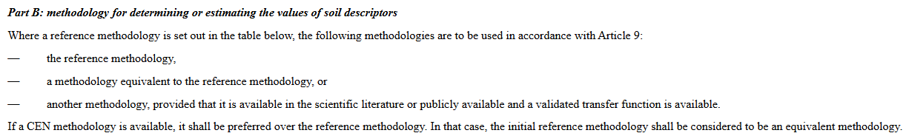

# Definitions {.unnumbered}

In this chapter, we will translate SML terminology and requirements in clear statistical notation and definitions.
@fig-SML is an extract from the SML (annex II, part B) and will be used as starting point:

:::{#fig-SML}

Extract from the Soil Monitoring Law, Annex II, part B

:::

Several elements from this SML-extract are detailed below.

**Soil descriptor**

A soil descriptor is a physical or chemical characteristic of a soil that can be measured based on a soil sample.
The SML contains a list of soil descriptors that should be reported by member states.
The same soil descriptor can be measured with multiple measurement methods.
Per soil descriptor, one measurement method is labeled as the reference method and all others as non-reference method.

**Reference method**

Reference methods are standardized protocols made by an international standards office (ISO, CEN, ...).
Reference methods are listed per soil descriptor in the SML.
For statistical notation, we denote the random variable that represents the soil descriptor as measured with the reference method as $Y$.

**Non-reference method**

All competing methods to measure the same physical or chemical property as the reference method is a non-reference method (eg. national or regional standards).
For statistical notation, we denote the random variable that represents the soil descriptor as measured with the non-reference method as $X$.

**Measurement error** 

A set of realizations of these random variables on $n$ locations are denoted by $\mathbf{y} = (y_1, \dots, y_n)$, $\mathbf{x} = (x_1, \dots, x_n)$.
However, due to measurement error we do not observe these latent properties of the soil at a particular location.
Measurement error is an umbrella term for all sorts of influences that result in a difference between the latent and observed values.
Two major components of the measurement error are the field protocol and the lab protocol.
Elements from the field protocol that affect measurement error are the sample support (area of the location, number of pooled sub-samples), the sample depth and sample method (auger vs. spade); these are the topic of WP3.
Measurement error from deviations from the lab protocols contribute to additional uncertainty.
Instead of the latent values, we have observed values $\mathbf{y}_{\text{obs}}$, $\mathbf{x}_{\text{obs}}$ at our disposal and in this StAP we will 

**Equivalent methods**

The SML mentions that the currently listed reference methods - which are all ISO-standards - will be considered equivalent to CEN methods which will then play the role of reference methods.
Other methods can also be considered to be equivalent to the reference method if certain statistical requirements are met.
In the next chapter 

**Transfer function**

A transfer function (TF) is a statistical model ($f$) that allows prediction of the soil descriptor values as would have been obtained with the reference methods when non-reference methods were used.
The observed non-reference method is the primary predictor variable, but auxiliary predictors $\mathbf{Z} = (Z_1, \dots, Z_p)$ can be included as well to allow for more accurate predictions.
The prediction should include a quantification of prediction uncertainty, i.e. the model should return both a point estimate and a prediction interval.
This statistical model needs to be estimated from data in which both methods were applied to the same soil samples.
In statistical notation, a TF is thus an equation of the form:
$$
\hat{Y},\left[\hat{Y}_l;\hat{Y}_u\right] = \hat{f}(X_{\text{obs}}, \mathbf{Z})
$${#eq-TF}
Different types of statistical models can be used for $f$ and we review several in the chapter on TF.

**Pedotransfer function**

A pedotransfer function (PTF) is a statistical model $g$ that allows prediction of a (hard to measure) soil descriptor from other (more easily measured) soil descriptors.
There is no primary predictor variable available that measures the same physical or chemical property.

$$
\hat{Y},\left[\hat{Y}_l;\hat{Y}_u\right] = \hat{g}(\mathbf{Z})
$${#eq-TF}

**Validation**

*Statistical validation* of a TF or PTF involves the calculation of validation metrics that assess the predictive performance based on external validation data, i.e. data that was not used to calibrate the TF/PTF.
Several metrics exist in the literature and will be used here. 
Different validation metrics assess different aspects of the predictive performance, so to get a complete picture, a combination of metrics is necessary. 

- Bias of the point estimates (MPE, MAE, RMSE)
- Precision of the point estimates (SDPE)
- Prediction uncertainty (PICP)
- Distributional metrics (ELPD, CRPS)

*Scientific validation* of a TF or PTF involves two main tasks.
The first task is to determine the domain of applicability of a TF/PTF.
The TF/PTF should not be used outside the domain of applicability in terms of the range of the soil descriptors that were used as predictors to calibrate the functions.
In addition, variables that do not appear as predictors in the TF/PTF but that were used as strata should be listed. 
The second task in scientific validation is to compare 

